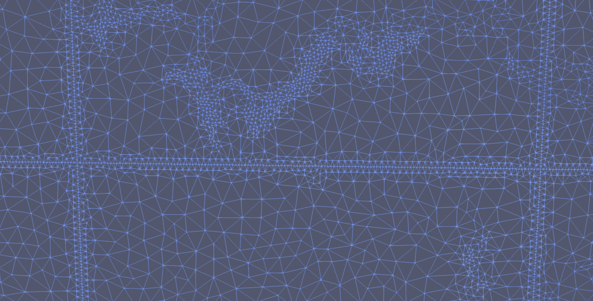
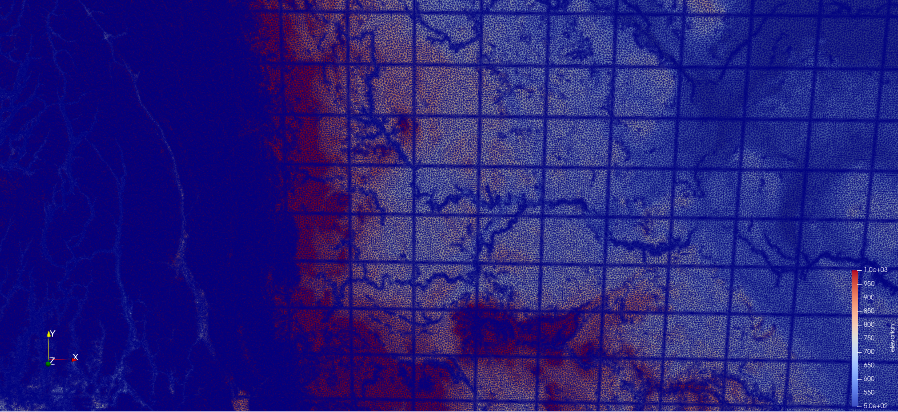

MPI
-----

Mesher can use MPI to regularize the input rasters in parallel,
and to do the regridding of the parameter rasters to the triangles. Mesher can also do a type of parallel mesh
generation. A few considerations about this are described below.

Mesher will invoke the MPI processes itself
++++++++++++++++++++++++++++++++++++++++++++++++

The main mesher application is single process and mesher will invoke the MPI sub-tasks itself. By default,
MPI Spawn will be used. This is only supported with OpenMPI and assumes that mesher is running in a context where
it makes sense to spawn MPI ranks (e.g., HPC job).  In constrained HPC context, it may be better to have the main
mesher process running in a small job and spawn MPI sub-jobs in dedicated jobs. This is where ``MPI_exec_str`` is used.
``MPI_exec_str`` can be a job submission script. Using the MPI spawn can sometimes not work, so setting
``MPI_exec_str=f'mpirun -n {MPI_nworkers} python '`` may be preferred.

Mesh seam
+++++++++++

The mesh generator is, by default, serial. For large meshes, this can be very slow. Enabling multiple MPI workers
will split the domain into subdomains and mesh each subdomain independently. Points are placed
along the seam, approximately spaced at the smallest allowed triangle size. This can be controlled with
``mpi_shared_edge_spacing``. Setting a lower density can ensure this boundary seam is not over reprsented, but the
triangles may not be strictly Delaunay while crossing the boundary. This can result in a regular pattern of small
triangles. This is more evident in areas with low topographic variability than in areas with high variability.

Independent refinement may add extra points to only one side of a shared edge.
After loading the merged MPI arrays (and after optional global Lloyd iterations),
Mesher reconciles these subdivisions before sampling elevations or face parameters.
It splits coarse triangles using existing boundary vertices, rebuilds global
neighbours, and requires each resulting seam segment to have a matching triangle
on the opposite side. It rejects unresolved hanging nodes, coincident boundary
vertices, degenerate/duplicate triangles, non-manifold edges, and gaps or
same-side overlaps along repaired edges. Coordinates are not moved; local area changes are bounded by the
XY detection tolerance (``1e-8`` in mesh coordinate units) and floating-point
roundoff. Reconciliation does not guarantee Delaunay/angle quality or check
arbitrary overlaps and coverage of the intended domain.

The log reports the number of split faces and added triangles. Triangle counts
and ordering can change, so parameter extraction and partitioning must use the
resulting mesh. Existing ``.param`` files and partition metadata must not be
attached to a mesh with repaired geometry.

Recovering an earlier MPI run
++++++++++++++++++++++++++++

If the previous run's intermediate directory and final stitched ``.npz`` are
still present, set the following in the original configuration and run Mesher:
::

   mpi_mesh = True
   reuse_mesh = True

Keep the original DEM/output paths and ``MPI_nworkers`` so the saved stitched
file can be located. Mesher skips tile triangulation, reconciles the loaded
arrays, and regenerates the exported mesh and face parameters. The stored
stitched NPZ is not modified. This workflow requires the original raster inputs
and configuration; it cannot recover a complete model from the ``.mesh`` alone.
Normal exported outputs are regenerated, so retain copies of any results you
need to keep. ``meshaudit --rebuild-neighbours`` remains a neighbour-only tool
and will refuse a mesh containing hanging nodes.

Zoom in of a seam

|image0-mpi|

|image1-mpi|

lloyd iterations
++++++++++++++++++
Global lloyd iterations breaks the alignment across the seams.

MPI mesh gen
+++++++++++++

To do the triangulation in parallel, ``mpi_mesh=True`` must be set.

